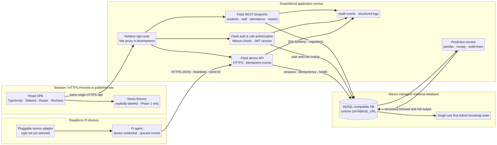
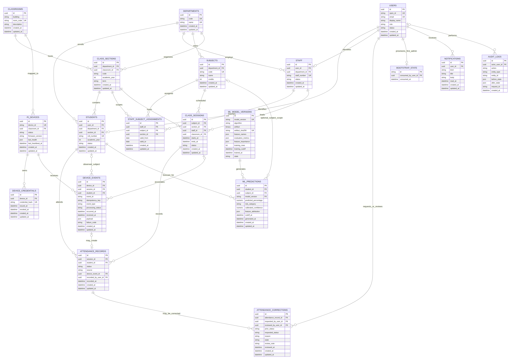
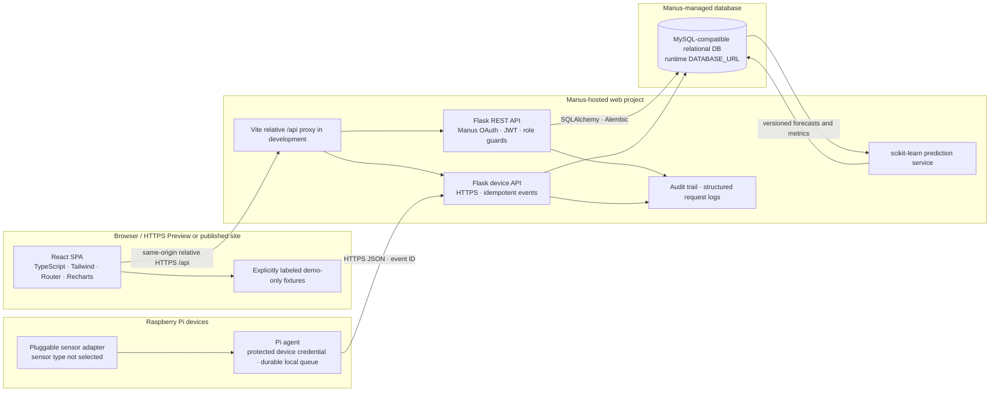

# SmartAttend AI — System Architecture

## Product and infrastructure boundary

SmartAttend AI is a college attendance workspace with Student, Staff and Admin roles. Its frontend is React + TypeScript + Tailwind; its API is Flask; its ORM/migrations use SQLAlchemy/Flask-Migrate; persistent application data uses the Manus-managed MySQL-compatible database. The user explicitly changed the earlier external PostgreSQL direction and requested that both API and database be in Manus. `server:true` and `database:true` are enabled on the project. The frontend and API run as the Manus-hosted web project; Flask reads the managed `DATABASE_URL` only at runtime.

The initial UI uses fictional fixtures only in conspicuously marked preview/demo mode; none of those figures are live college records. Do not seed these values into the managed database. The same Manus-managed database is shared between Cloud development and publication, so integration tests use a separate local/isolated database and never reset/delete managed data.

## System topology

`docs/system-architecture.mmd` is the standalone architecture source; `docs/attendance-er.mmd` is the managed-database ERD source. PNG renderings are generated from these Mermaid sources.

## Authentication and authorization

Sign-in uses Manus OAuth because the request did not specify another provider. Bind OAuth state to a short-lived single-use nonce cookie, use the browser-visible origin for redirects, exchange the authorization code server-side and resolve the returned identity to a database-backed user and role. Preserve the Preview-compatible application cookie name `webdev_app_session`; validate platform-signed Preview JWTs against `MANUS_JWT_SECRET`, HS256, expiry and `MANUS_PROJECT_ID`. Public HTTPS Preview application session cookies use `SameSite=None; Secure`; plain-HTTP local behavior is separately configured. Do not treat the Preview gateway, a forwarded header or the demo role selector as authentication.

Enforce authorization on every API: a Student can fetch only their own profile, attendance, notifications and predictions; Staff can read/mark/correct attendance only for assigned classes/subjects; Admin manages identities, courses, assignments, devices and reports. Staff corrections preserve requester, reviewer, time, previous value and reason. Role changes and privileged actions are audited. The first Admin is provisioned from a signed-in pending Manus identity using the protected bootstrap secret and one durable unique `bootstrap_state` row that is consumed atomically and never reusable; do not leave self-service role escalation open. Device credentials are distinct from user sessions, issued per-device, stored as verifiers, revocable and never logged.

## API and event boundaries

The React client calls same-origin relative `/api` paths via one Axios client. Development Vite proxies `/api` to Flask; production Flask/Gunicorn serves the compiled SPA and REST API from the same container on `PORT` (default 3000). API errors use a consistent JSON shape and request/correlation IDs. The application has loading, empty, offline and error states. Production device APIs require HTTPS; CORS is restricted to explicitly configured origins when cross-origin access is needed.

Required device routes are `POST /api/device/register`, `POST /api/device/heartbeat`, `POST /api/device/attendance`, `GET /api/device/status` and `GET /api/admin/devices`. Requests carry device authentication, event ID, timestamp and idempotency key. Unique database constraints prevent replay from creating duplicate attendance. A Raspberry Pi agent stores failed network submissions in a local durable queue and retries with exponential backoff using the original event identity. Server acknowledgements distinguish accepted, duplicate and rejected events. Device-to-classroom mapping is administered; no particular sensor or wiring is assumed.

## Data and prediction lifecycle

Attendance belongs to a class session and student, with unique session/student and device-event/idempotency constraints plus source and audit metadata. Device receipt is distinct from accepted attendance; event IDs remain traceable through validation and idempotent processing. Online/offline status is derived from the last saved heartbeat with its observation time, never from demo fixtures.

ML features are computed only from attendance data available at the prediction cutoff. Use chronological train/test evaluation (not random row splitting), persist the model artifact/version, cutoff, metrics and feature importance in the managed database, and store predictions separately from attendance facts. Confidence stays null unless calibration has been evaluated. Return generated time, model version, risk category and important influencing features; disclose model limitations. Do not train or predict on synthetic sample rows.

## Deployment and operations

A multi-stage Docker build installs the pinned Node toolchain, builds the SPA, installs pinned Python requirements and starts Flask/Gunicorn on the platform-provided `PORT`. Secrets/runtime values are never baked into the image; no managed `DATABASE_URL` is required during compile. Application migrations are explicit and repeatable; do not drop/recreate the shared managed schema during tests.

Terminate TLS at the hosting edge; enforce HTTPS for Pi traffic. Configure CORS only for actual UI origins. Managed database durability is platform-provided, but the available platform database contract does not expose a separate asynchronous backup/PITR/restore API. Document any export/backup workflow only when an actual DB client route is configured; do not claim a backup completed without evidence. CSV/PDF reports are business exports, not full database backups. Emit structured logs with request IDs, device event IDs and non-sensitive status; do not log cookies, bearer tokens, student payloads or connection strings. Monitor liveness/readiness, DB connection state, migration version, device heartbeat age, retry backlog, API error rates and model-evaluation health.

## Module map

- `src/` — React pages/components, route-aware application shell, centralized Axios client and clearly labeled Phase 1 demo fixtures.
- `backend/app/api/` — Flask auth, students, staff, admin, attendance, subjects, devices, predictions, notifications and reports.
- `backend/app/models.py` — SQLAlchemy entities and relationships for the Manus-managed MySQL-compatible database.
- `backend/app/services/` — role/assignment access checks, serialization, audit events and business services.
- `backend/migrations/` — versioned Alembic schema changes.
- `backend/tests/` — isolated database tests; no destructive managed-DB testing.
- `iot/` — hardware-neutral Pi client, retry queue and sensor protocol.
- `smartattend_ml/` — features, chronological model evaluation, training and prediction.
- `docs/` — architecture and rendered topology/ERD, OpenAPI, deployment, Pi setup, ML limitations and test strategy.
